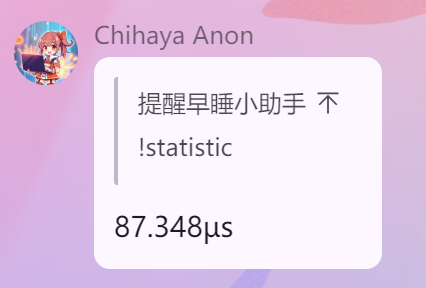

# Kanami

A suckless styled QQ bot client works with NapCat.


## Motivation

py 虽然拿来写 bot 很舒服，但还是存在一些局限性：

1. 注解系统不够强大，比如异步函数忘调用 await 却没有提示，在代码 push 上去运行后才发现。
2. rs 的编译器检查可以你在写插件时排除掉绝大多数类似 1 的问题。
3. 对于错误处理，一个问号丢到上层比一堆 try except 舒服。
4. 我 vps 内存小，[anon](https://github.com/jerrita/anon)(py) 占用 40M，kanami(rs) 占用 5M
5. 这玩意只要编译通过了，很难爆炸。
6. 小蓝梁喜欢 rs。
7. 我导师喜欢 rs。
8. 我是变态，为了这点醋包的饺子。
9. Bang 15 便士。

## Design

不想写，你只要知道性能挺高就行。有兴趣看 `src/protocol/adapter.rs`。核心逻辑 100 行。

## Usage

1. fork 本项目
2. `cp config.example.toml config.toml`，填写 NapCat 连接信息和各应用配置
3. 通过顶层 `apps = ["builtin", "ping", ...]` 选择应用及启动顺序，配置放在 `[app.<name>]`；停用时可保留配置段
4. 启动时读取配置一次，修改后重启生效；缺字段、未知字段或类型错误都会使启动失败

`endpoint`、`token`、`owner`、`apps` 是必填的系统字段。各应用保留的部署配置如下：

- `builtin`、`ping`：无需配置段。
- `[app.chat]`：`token`、`base_url`、`default_model`、`system_prompt`、`rate_limit_window_secs`、`rate_limit_max`、`history_max_length`、`max_message_length`，用于设置服务连接、回复行为和用量限制。
- `[app.gscore]`：`endpoint`、`bot_id`、`node_sender_id`、`node_sender_nickname`，用于设置服务连接和转发身份。
- `cat`、`muri`：无需应用配置；示例仅配置框架名单。
- `[[app.cron.jobs]]`：`schedule`、`target`、`content`，配置推送时间、目标和文案；target 使用 `{ type = "group" | "private", id = 整数或别名 }`，cron 表达式使用 UTC。

每个应用段可选 `groups = { allow = [...] }` 或 `groups = { deny = [...] }`，`users` 同理，每种名单只可选一种模式。不写则不限制，空 allow 拒绝所有带相应 ID 的事件，空 deny 不限制。群名单作用于所有带 `group_id` 的消息、通知和请求；用户名单作用于所有带 `user_id` 的事件。无相应 ID 的事件不受该名单限制。框架在进入应用处理函数前过滤，名单字段不进入应用自身的配置。

`[alias.group]` 和 `[alias.user]` 定义独立的群号和 QQ 号别名，例如 `main = 114514`、`owner = 1919810`。系统 `owner`、群/人名单、cron 目标 ID、gscore 的 `node_sender_id` 均可使用整数或相应命名空间的别名字符串；未定义的别名会使启动失败，运行期只使用解析后的 `i64`。不再保留系统 `main_group` 和 cron 的 `main_group` target，改用群别名（如 `{ type = "group", id = "main" }`）。

TOML 的同一个键不能同时用作数组和表，因此启用列表用 `apps`，应用配置用单数的 `[app.<name>]`。

完整字段见 `config.example.toml`，启用的应用不提供字段默认值；未启用的配置段保留但不解析。列表中或配置段中的未知应用名、列表中重复的应用名会使启动失败。只将部署者确有必要修改的通用行为暴露为配置；muri 词库、cat API 地址及每次最多 3 张图、chat 的摘要文案、限流提示和发送间隔保留在应用代码里。解析失败时报告字段路径，不打印配置文件原文。

配置默认从当前工作目录的 `config.toml` 读取，也可用 `KANAMI_CONFIG` 指定路径（相对路径仍相对于当前工作目录）。私有配置已被 gitignore，不要提交 token。

```bash
# endpoint 以 wss:// 开头时
cargo run --release --features=tls
# 否则
cargo run --release
# 指定配置路径和日志级别
KANAMI_CONFIG=/path/to/config.toml LOG=debug cargo run --release
```

使用 `run.sh` 部署时同样可设置 `KANAMI_CONFIG`，脚本会继承该环境变量。

开发新应用时，参考 `src/application/template.rs` 实现 `Application`，在应用模块里定义带 `deny_unknown_fields` 的配置结构体，在 `src/application/mod.rs` 注册表增加一行 `mount::<YourApp>()`；同时更新 `config.example.toml`。配置中的群号/QQ 号字段用 `i64`，分别标注 `#[serde(deserialize_with = "crate::config::group_id")]` / `user_id` 来支持别名。

应用统一实现 `Application`：`NAME`、`Config`、`new`、`start` 和 `on_event`。启动时先构造所有应用，再依次完成 `start`，之后才连接 NapCat；构造或启动失败会退出。WS 重连只恢复连接，不重复启动应用。事件仍通过每个应用的互斥锁串行进入处理函数。

## Evaluation

实验环境如下：
```
CPU: AMD EPYC 9274F 24-Core @ 48x 4.05GHz 
OS: Arch Linux x86_64 Linux 6.15.2-arch1-1
```

对从接收到消息开始，到插件处理完成的耗时大致如下：

